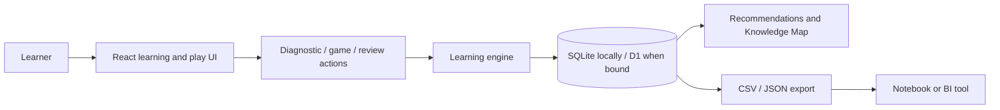

# Clue Atlas

> **Know more. Know what to learn next.**

Clue Atlas is a learning studio for people who want to get better at bar trivia,
quiz-show-style play, and technical subjects such as data engineering,
statistics, and data science. It combines a diagnostic, retrieval practice,
Anki-style review scheduling, explainable gap prioritization, games, and an
analysis-ready attempt log.

The idea is simple: do not study everything equally. Measure what appears often,
what you are least likely to recall, and what is valuable in the kind of game you
care about. Then practice the highest-return connections at the moment they are
most useful.

## Why these categories first?

The opening curriculum emphasizes durable, reusable knowledge with strong links
across many trivia formats:

1. Geography
2. U.S. history and presidents
3. World history
4. Science and nature
5. Literature and language
6. Religion and mythology
7. Visual art and classical music
8. Film, television, and popular music
9. Sports
10. Food, drink, and everyday culture

An introductory **How Clues Work** unit teaches clue parsing, recurring
associations, confidence calibration, and when to pass. Optional overlays then
tilt the plan toward **Bar Trivia**, **Quiz-Show Training**, or **Data Studio**.
See [the curriculum guide](docs/CURRICULUM.md) for the rationale and sequence.

## What makes Clue Atlas different?

- **A useful diagnostic:** correctness, confidence, and response time turn “not
  sure” into information rather than a penalty.
- **An explainable next step:** every recommendation can show the frequency,
  personal gap, and game value behind it.
- **Signal Cards:** compact recurring clue-to-answer associations support fast
  retrieval without replacing real understanding.
- **Spaced review:** a four-button recall rating schedules the next useful
  encounter and records the full history.
- **Play with a purpose:** daily review, gap sprints, and board-style rounds all
  update the same knowledge model.
- **A real analytics substrate:** append-only attempts, stable dimensions, and
  documented CSV/JSON exports make the project suitable for a data portfolio.
- **Your own learning studio:** the same model can hold capitals, painters, SQL
  window functions, causal inference, or anything else worth retrieving.

## Method: inspired by Colin Davy, adapted for personal learning

In [“How I Won Jeopardy With Data
Science”](https://colindavy.medium.com/how-i-won-jeopardy-with-data-science-c2e9b52a1958),
Colin Davy describes finding frequently recurring answers, extracting repeated
high-information clue phrases, and turning them into rapid-study cards. Clue
Atlas borrows the strategy—not his dataset or cards—and adds a personal gap
model and explicit game weighting:

```text
opportunity = frequency × personal gap × game value
review priority = opportunity × due urgency
```

The score is deliberately inspectable. “Why this next?” should always be
answerable in ordinary language. Full definitions and scheduling behavior live
in [the learning-engine guide](docs/LEARNING_ENGINE.md).

## Project status

Clue Atlas is an **early MVP**, not a finished learning platform. This repository
is building the product shell, representative learning flows, an extensible data
model, and portfolio-grade documentation. Seed content is intentionally small.

Unless a release explicitly says otherwise, do not assume the current MVP has:

- a comprehensive trivia corpus;
- production-grade account sync or multi-device persistence;
- a validated adaptive-testing or FSRS model;
- multiplayer, public leaderboards, voice judging, or offline support; or
- automated ingestion from third-party trivia archives.

Those boundaries are intentional. They let the core retrieval loop and data
contract mature before the system grows. See [Product & roadmap](docs/PRODUCT.md)
for the current scope.

## Quick start

### Prerequisites

- Node.js `>=22.13.0`
- pnpm (recommended through Corepack)

```bash
corepack enable
pnpm install
pnpm dev
```

Open the local URL printed by the development server.

Validate a change with:

```bash
pnpm lint
pnpm build
pnpm test
```

The repository also retains npm-compatible scripts:

```bash
npm install
npm run dev
```

Use one package manager consistently in a pull request; CI uses the committed
pnpm lockfile.

## Architecture at a glance

Clue Atlas uses TypeScript, React, the Next app-router programming model through
[vinext](https://github.com/cloudflare/vinext), and a Cloudflare Worker entry
point. Drizzle provides a typed SQLite/D1 schema. The intended production shape
is one application with explicit domain boundaries rather than a fleet of
services.



Read [Architecture](docs/ARCHITECTURE.md) and [Data model](docs/DATA_MODEL.md)
before making structural changes.

## Data and content policy

Clue Atlas ships only original clue wording and content whose license clearly
permits reuse. It does **not** ship a J! Archive corpus or scraper. A public fact
may inspire an original question, but copied clue text is not acceptable. Every
import must carry source, license, and attribution metadata.

This project is inspired by quiz shows but is not affiliated with or endorsed by
Jeopardy Productions, Inc., Sony Pictures, or J! Archive. See [Data sources &
licensing](docs/DATA_SOURCES.md) before contributing content.

## Documentation

- [Product & roadmap](docs/PRODUCT.md)
- [Curriculum](docs/CURRICULUM.md)
- [Learning engine](docs/LEARNING_ENGINE.md)
- [Data model & event grain](docs/DATA_MODEL.md)
- [Architecture, development & deployment](docs/ARCHITECTURE.md)
- [HTTP API](docs/API.md)
- [Analytics, SQL & exports](docs/ANALYTICS.md)
- [Data sources & licensing](docs/DATA_SOURCES.md)
- [Opportunity-score walkthrough](notebooks/README.md)
- [Contributing](CONTRIBUTING.md)
- [Security policy](SECURITY.md)

## Contributing

Issues and focused pull requests are welcome. Code, content, curriculum, and
analysis contributions have different review needs; [CONTRIBUTING.md](CONTRIBUTING.md)
describes each path. By participating, you agree to the
[Code of Conduct](CODE_OF_CONDUCT.md).

## License

Code and original documentation in this repository are available under the
[MIT License](LICENSE). Imported or attributed content may carry its own license
and must remain traceable to its source manifest.
