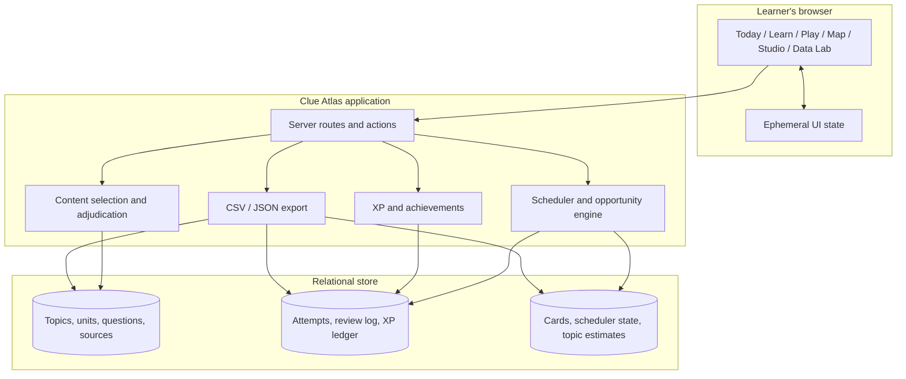
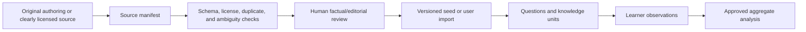

# Architecture, development & deployment

Clue Atlas is designed as a compact full-stack application with an explicit
learning domain and an analysis-ready relational model. The MVP avoids a
distributed architecture: question selection, answer evaluation, scheduling,
rewards, and projections belong in one transactional boundary.

## Technology

- TypeScript and React
- Next app-router APIs through [vinext](https://github.com/cloudflare/vinext)
- Vite and a Cloudflare Worker entry point
- Drizzle ORM with SQLite-compatible schema and Cloudflare D1 as the intended
  hosted store
- Node.js 22 for development and CI
- pnpm as the canonical CI package manager

The repository is compatible with npm scripts for convenience, but contributors
should not churn both lockfiles in one change.

## System context



## Request path

A correct attempt path should look like this:

1. authenticate/resolve the learner or an explicit local demo learner;
2. validate the payload and idempotency key;
3. load the question, aliases, card, and scheduler state;
4. normalize and adjudicate the response;
5. force the effective rating to `again` on a miss;
6. compute a deterministic scheduler transition;
7. in one transaction, append the attempt/review/XP facts and update current
   state;
8. refresh affected topic and achievement projections;
9. return the result, explanation, XP, and next due time.

The scheduler is a pure function of state, rating, correctness, and an explicit
timestamp. Keeping it pure makes tests and retrospective analysis reproducible.

## Code boundaries

The exact directory shape may evolve, but dependencies should point inward:

```text
app/                 pages, layouts, route handlers, UI composition
lib/                 learning-domain functions and seed/content services
db/schema.ts         authoritative Drizzle schema
drizzle/             generated, reviewed migrations
worker/              Cloudflare request entry point
tests/               behavior and rendered-output verification
notebooks/           analysis examples over exported or synthetic data
docs/                product, method, model, architecture, and policy
```

Domain functions must not import UI components. UI may call domain services but
should not reimplement scheduler math, opportunity math, answer normalization, or
XP rules in the browser.

## Content pipeline

The safe content path is:



There is no J! Archive ingestion branch. Frequency analysis operates on approved
content plus learner attempts. Generated content, if introduced later, must be
marked, reviewed, and sourced like any other draft.

## Local development

### Requirements

- Node.js `>=22.13.0`
- pnpm through Corepack, or a recent explicit pnpm install

```bash
corepack enable
pnpm install
pnpm dev
```

The development server prints its local URL. The vinext/Vite configuration keeps
local Worker state inside the project.

Useful checks:

```bash
pnpm lint
pnpm build
pnpm test
```

Generate a migration after an intentional schema change:

```bash
pnpm db:generate
```

Review every generated migration and commit it with the schema change. Migration
generation is not migration application.

### npm equivalent

If pnpm is unavailable, the existing scripts can be invoked through npm:

```bash
npm install
npm run dev
npm run lint
npm run build
npm test
```

CI uses pnpm and its frozen lockfile, so validate with pnpm before requesting
review when possible.

## Database environments

The Drizzle schema uses the SQLite dialect so local SQLite-compatible databases
and D1 share the relational design. Hosted persistence requires a D1 binding.

The MVP API runs an idempotent database/catalog initializer on first access. That
makes a fresh bound D1 useful without a separate seed command, but runtime DDL is
not the long-term production migration strategy. As the schema stabilizes,
generate and apply reviewed migrations during release while retaining only safe,
versioned catalog upserts at runtime.

The hosting manifest declares the D1 binding name `DB`. The target environment
must still provision and attach the actual database; a name in the manifest does
not create durable storage by itself. When `DB` is unavailable, the UI can render
its explicit demo fallback, but that state must not be described as durable or
multi-device persistence.

For each real environment:

1. create a separate database—never share development and production;
2. apply reviewed migrations in order using the hosting provider's D1 migration
   process;
3. bind the Worker to that database with the binding name expected by the app;
4. seed only original/clearly licensed content;
5. run a smoke attempt and verify attempt, review log, scheduler state, and XP
   reconcile;
6. verify learner export and deletion behavior before external onboarding.

Do not commit database IDs, access tokens, user exports, or production dumps.

## Deployment

Before deployment:

```bash
pnpm install --frozen-lockfile
pnpm lint
pnpm build
pnpm test
```

The repository has a Cloudflare-compatible Worker and an OpenAI Sites hosting
manifest. Connect the intended hosting environment, configure its D1 binding if
durable persistence is required, apply migrations, and deploy the successful
build through that platform.

There is intentionally no generic `pnpm deploy` command documented today because
the repository does not define one and database binding/application is
environment-specific. Add a deploy script only when it captures the complete,
repeatable process; until then, follow the selected platform's reviewed release
workflow rather than inventing a command.

### Release checklist

- CI is green on Node 22.
- The deployed commit SHA is recorded by the platform.
- Schema and applied migrations agree.
- No placeholder or unlicensed content is newly exposed.
- Keyboard-only diagnostic/review/play smoke tests pass.
- Reduced motion and timer-off behavior still work.
- A duplicate attempt retry does not add XP or advance the scheduler.
- CSV and JSON exports exclude other learners and disclose a schema version.
- Rollback steps for both application and schema are known.

## Observability

Prefer structured, low-cardinality operational events:

- route, status, latency, release version;
- transaction success/failure category;
- idempotent retry count;
- due-queue and projection-refresh latency;
- content validation failures by rule.

Do not log emails, raw answers, question text, confidence, access tokens, or full
request bodies. Product analytics belong in the relational event model with
clear learner controls, not opportunistic server logs.

## Failure modes

| Failure | Expected behavior |
| --- | --- |
| Attempt request retries | Return the existing attempt; no duplicate review or XP |
| Projection refresh fails | Preserve committed facts; retry/rebuild the projection |
| Content becomes disputed | Deactivate future selection; preserve historical keys |
| Scheduler policy changes | Keep old review facts; write a new scheduler version |
| D1 is not bound | Surface a clear non-durable/unavailable state; do not imply sync |
| Export is interrupted | Generate again from immutable facts with the same schema version |

## Architecture decisions

Short decisions with long-lived consequences are recorded under [`docs/adr/`](adr/):

- [ADR 0001: Original and clearly licensed content only](adr/0001-original-licensed-content.md)
- [ADR 0002: Attempts as the canonical learning event](adr/0002-attempt-event-log.md)
