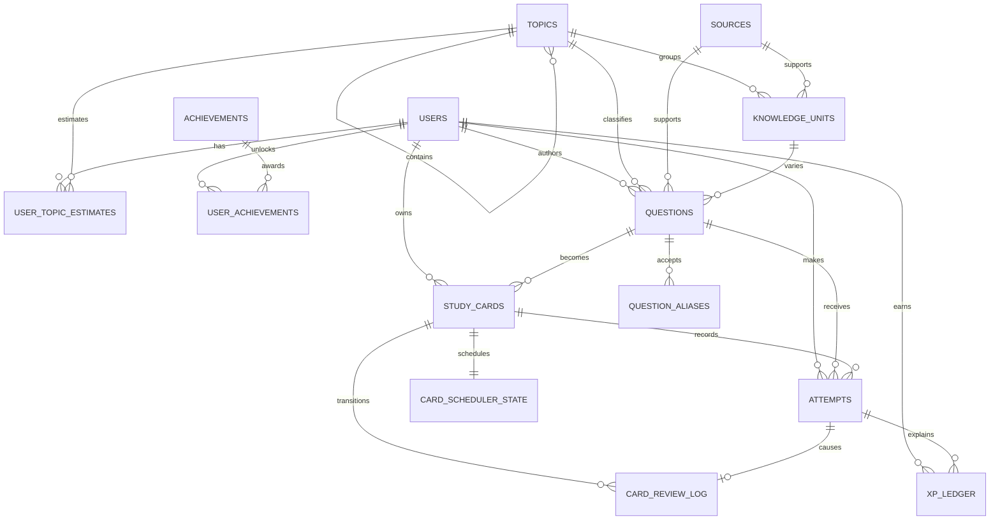
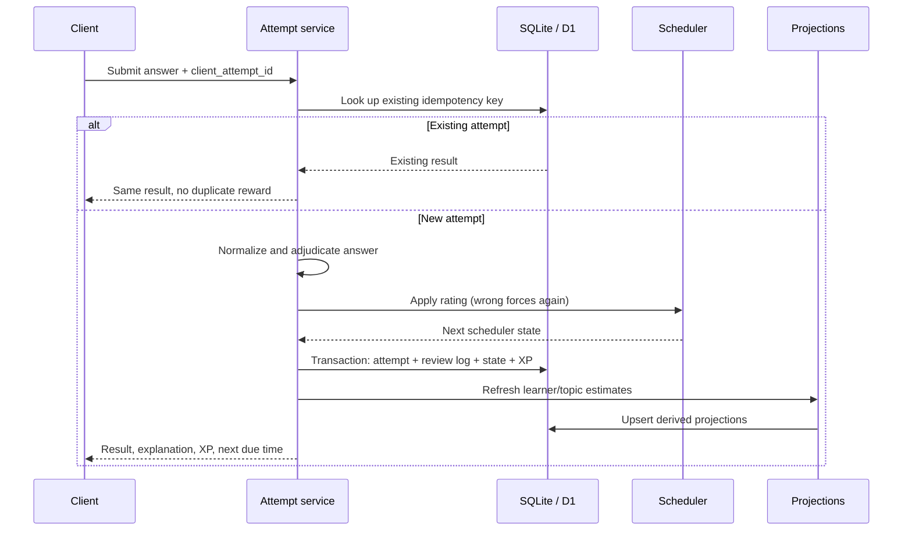

# Data model & event grain

The Clue Atlas database is both application state and an analysis-ready learning
record. Its central design decision is to preserve raw attempts and review
transitions while keeping rebuildable learner/topic estimates for fast product
reads.

The typed schema in [`db/schema.ts`](../db/schema.ts) is authoritative. This
document explains its semantics and invariants.

## Grain first

### `attempts`

**One row represents one learner's final evaluated response to one presented
question at one point in time.**

An attempt is created for a submitted answer or an explicit pass. It is not a
keystroke, page view, clue reveal, or aggregate. The row keeps the raw response,
normalized response, result, answer-match path, recall rating, response time,
confidence plus whether it was explicitly provided, hint use, mode, XP
attribution, and event time.

`client_attempt_id` is supplied by the caller and unique within a user. Retrying
the same write must return the existing result instead of creating another
attempt or awarding XP twice.

Version 1 stores the broad interaction `mode` but not a durable session/round ID
or separate clue-presentation event. That is sufficient for card-level learning
analysis, but exact funnel, abandonment, and within-round sequence analysis is
roadmap work and will require a new documented event grain.

### `card_review_log`

**One row represents one scheduler-state transition caused by one rated
attempt.**

It records the before and after ease, interval, and due time. `attempt_id` is
unique, preventing one answer from advancing a card twice.

### `xp_ledger`

**One row represents one XP credit or debit for one reason/reference pair.**

`users.xp_total` is a convenient current balance; the ledger is the audit trail.
The uniqueness rule on user, reason, and reference makes rewards idempotent.

### `user_topic_estimates`

**One row represents the latest derived estimate for one learner/topic pair.**

This is a cache, not an event log. It can be recomputed from attempts and the
active content catalog. Store the update timestamp and version recommendation
logic when the estimate formula changes materially.

## Entity relationship model

## Table dictionary

### Identity and taxonomy

| Table | Purpose | Important fields |
| --- | --- | --- |
| `app_metadata` | Database-level bootstrap/version markers | `key`, `value`, `updated_at` |
| `users` | Learner identity and small current-state aggregates | `email`, `display_name`, `xp_total`, `streak_days`, `last_study_date` |
| `topics` | Hierarchical curriculum/category dimension | `slug`, `parent_id`, `kind`, `importance_weight`, `is_core`, display metadata |
| `sources` | Provenance and rights record | `title`, `url`, `author`, `license`, `notes`, `accessed_at` |

`topics.kind` separates `trivia` and `studio` material without creating parallel
learning systems. A topic may point at another topic through `parent_id`.

### Content

| Table | Purpose | Important fields |
| --- | --- | --- |
| `knowledge_units` | Durable concept/answer and its signals | `topic_id`, `canonical_answer`, `pavlov_cues_json`, `importance`, `difficulty`, `source_id` |
| `questions` | Original retrieval prompt variants | `knowledge_unit_id`, `topic_id`, `prompt`, `answer`, `explanation`, `format`, `difficulty`, `value`, provenance/ownership, `fingerprint`, `is_active` |
| `question_aliases` | Explicit acceptable-answer variants | `question_id`, `alias`, `normalized_alias` |

The database field `pavlov_cues_json` stores the ranked signal phrases used by
Signal Cards. It must be valid JSON representing an array; callers should not
depend on unvalidated arbitrary objects.

`questions.topic_id` is intentionally repeated for efficient topic selection. It
must equal the topic on its referenced knowledge unit. Creation/update code and
data-quality tests must enforce this cross-table invariant.

For learner-created content, `fingerprint` plus the non-null owner supports
per-learner duplicate prevention. Seed rows have a null owner, so the content
pipeline must also enforce deterministic seed IDs/fingerprints. In every case a
fingerprint is a deduplication aid, not a substitute for editorial review.

### Learning state and facts

| Table | Purpose | Important fields |
| --- | --- | --- |
| `study_cards` | One learner/question relationship | unique `user_id` + `question_id`, `status` |
| `card_scheduler_state` | Current scheduling state for a card | ease, interval, repetitions, lapses, `due_at`, `scheduler_version` |
| `attempts` | Append-only response fact | idempotency key, answer/result, rating, confidence + provided flag, hint use, timing, mode, XP, timestamp |
| `card_review_log` | Append-only schedule transition audit | attempt, rating/result, before/after ease, interval, and due timestamps |
| `xp_ledger` | Idempotent reward audit | reason, reference, amount, timestamp |
| `user_topic_estimates` | Rebuildable topic-level serving cache | counts, mastery, coverage, opportunity, calibration summaries |

A diagnostic or play response may create a study card before recording its first
attempt. This keeps `attempts.card_id` non-null and lets all modes feed the same
review model.

### Achievements

| Table | Purpose | Important fields |
| --- | --- | --- |
| `achievements` | Reusable achievement definition | slug, metric, threshold, reward |
| `user_achievements` | One learner's unlocked achievement | unique learner + achievement, `unlocked_at` |

Achievements are projections over learning behavior. They must not replace the
attempt or XP ledgers.

## Required invariants

1. IDs are stable opaque text values; never encode mutable meaning in an ID.
2. Timestamps are UTC ISO-8601 strings so lexical and chronological order agree.
3. The raw answer is never overwritten by normalization or later adjudication.
4. One user/client-attempt key produces at most one attempt.
5. One attempt produces at most one review transition.
6. Wrong responses are scheduled as `again`, regardless of a more generous
   client-supplied rating.
7. A card belongs to the same user as its scheduler state, attempt, and review
   log.
8. A question topic matches its knowledge unit topic.
9. Cached user totals and topic estimates must be reproducible or reconcilable
   from facts.
10. Deactivating content preserves historical attempts; it only removes the item
    from future selection.
11. Seed/imported content has reviewable provenance and license metadata.

## State versus history

Use the current-state tables to serve the application quickly:

- due queue → `card_scheduler_state`;
- category map → `user_topic_estimates`;
- streak/XP header → `users`;
- unlocked badges → `user_achievements`.

Use facts for analysis and audit:

- learner behavior → `attempts`;
- scheduling policy effects → `card_review_log`;
- reward reconciliation → `xp_ledger`.

If a cache disagrees with its facts, preserve the facts and rebuild the cache.

## Data flow

The transaction boundary prevents a correct answer from being recorded without
its corresponding scheduler update, or XP from being granted twice.

## Deletion and privacy

Raw answers, response times, and confidence are learner data. Production work
must define account export and deletion, retention, encryption, access control,
and backup policies before inviting external users. Avoid putting emails or raw
answers into logs. Analytics exports should default to the current learner and
use stable pseudonymous IDs when shared.

The MVP schema uses cascading foreign keys for user-owned learning state. A
production deletion flow should run in a transaction, verify affected rows, and
document whether operational backups age out later.

## Schema evolution

- Change `db/schema.ts`, then generate a migration with `pnpm db:generate`.
- Review generated SQL; do not edit applied migrations in place.
- Backfill derived columns from facts where possible.
- Add a version field before changing scheduler or estimator semantics.
- Keep exports backward-compatible for a documented window, or publish a new
  export schema version.
- Test migrations against a representative copy, including foreign-key checks.
